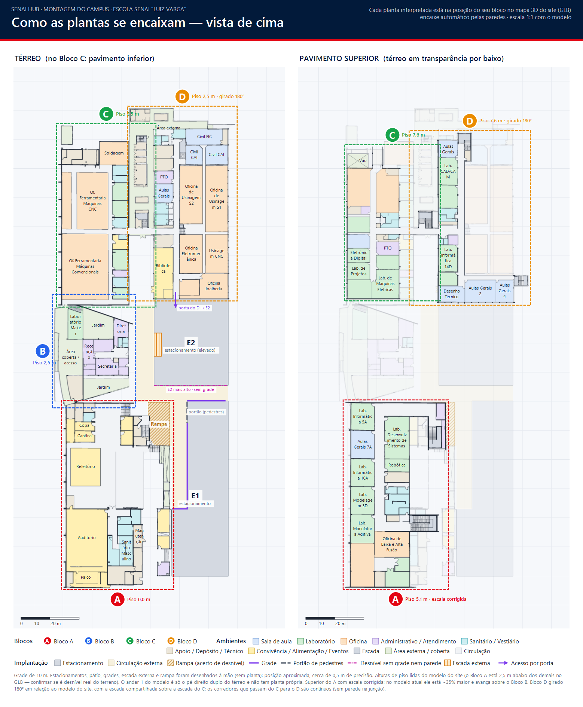
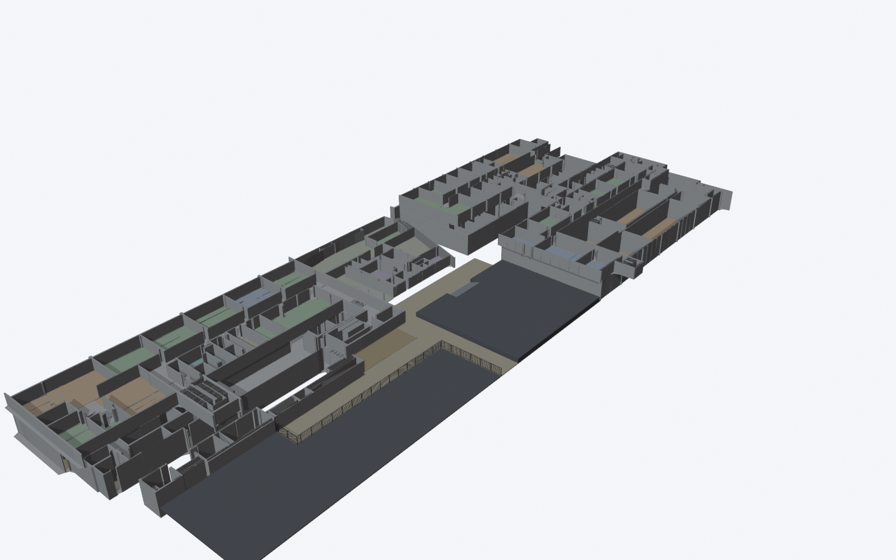

# Novo Projeto Mapa

Plantas interpretadas (salas com nome e tipo), montagem do campus SENAI sobre os modelos 3D do site,
implantação (estacionamentos, rampa, grades) e os novos modelos 3D com salas separadas, gerados no Blender.

- **Contexto completo, decisões, formatos e próximos passos:** [CONTEXTO.md](CONTEXTO.md)
- **Rodar o pipeline:** `powershell -ExecutionPolicy Bypass -File "scripts\rodar-pipeline.ps1"`
- **Gerar os modelos 3D:** `blender -b --factory-startup -P scripts\blender\gerar-campus.py`
- **Resultado:** `saida/Montagem-implantacao.png`, `saida/Bloco*.png`, `saida/blender/glb/*.glb`, `saida/blender/*.png`

